  

# 🎮 Awesome Multiplayer Game Servers & Networking 🌐

  
  
  
  
  

---

## 📌 Overview & SEO Summary 🚀

Welcome to the definitive curated directory of **Multiplayer Game Servers, Low-Latency Networking Frameworks, and Dedicated Server Infrastructure**. Whether you are building real-time competitive multiplayer FPS shooters, fighting games with deterministic rollback netcode, MMORPG persistent worlds, turn-based card battles, or mobile io games, this list indexes the industry-leading **SaaS managed backend providers** and top-starred **open-source netcode libraries**.

Key technology domains covered:
- ⚡ **Transport Protocols & Reliable UDP**: Low-level reliable/unreliable packet delivery via UDP, QUIC, and WebTransport (`GameNetworkingSockets`, `ENet`, `KCP`, `LiteNetLib`).
- 🔄 **Rollback & Prediction Netcode**: Deterministic lockstep and frame rollback engines for zero perceived latency (`GGPO`, `GGRS`, `Quantum`).
- 🏛️ **Authoritative Game Servers & BaaS**: Distributed state synchronization, matchmaking, inventory, lobbies, and chat (`Nakama`, `Colyseus`, `SpacetimeDB`, `PlayFab`).
- ☸️ **Game Server Orchestration & Fleet Autoscaling**: Kubernetes-native dedicated server life-cycle management (`Agones`, `Open Match`, `Hathora`, `GameLift`).

---

## 📑 Table of Contents
- [Sector Overview & Market Dynamics](#-sector-overview--market-dynamics)
- [SaaS & Hosted Multiplayer Platforms](#-saas--hosted-multiplayer-platforms)
- [Open-Source Netcode & Game Server Frameworks](#-open-source-netcode--game-server-frameworks)
- [Key Architectural Archetypes](#-key-architectural-archetypes)
- [Star History](#-star-history)
- [Support](#-support)
- [How to Contribute](#-how-to-contribute)
- [Disclaimer](#-disclaimer)

---

## 📊 Sector Overview & Market Dynamics

The multiplayer game server hosting and backend services market is estimated at **$4.5B to $5.2B in 2026**, growing at a rapid ~14.8% CAGR driven by cross-platform play, live-service games (GaaS), and edge computing deployment. The sector exhibits a **moderately fragmented** structure: hyperscalers (Microsoft Azure PlayFab, Amazon GameLift) dominate large-scale AAA dedicated server fleets, yet nimble specialized SaaS engines (Photon Engine, Hathora, Colyseus Cloud) and extensible open-source frameworks (Nakama, Agones, SpacetimeDB) capture substantial indie, mid-tier, and custom game studio workloads.

---

## ☁️ SaaS & Hosted Multiplayer Platforms

The table below lists leading managed multiplayer platforms and Backend-as-a-Service (BaaS) engines, sorted in **descending order by company valuation/revenue**.

| Provider / Platform 🏷️ | Scale / Valuation / Revenue 🏢 | Pricing (Starting Tier) 💵 | Free Tier / Trial Limits 🎁 | Primary Capabilities 🛠️ |
| :--- | :--- | :--- | :--- | :--- |
| **[Microsoft Azure PlayFab Multiplayer](https://playfab.com)** | **$3.1T Market Cap** (Microsoft parent; gaming unit $21B+ annual rev) | Pay-as-you-go starting at **$0.005/player-hour** + $99/mo Standard BaaS plan | **100,000 monthly active users (MAU)** free forever with core player data, cloud script, and economy APIs | Enterprise BaaS, dynamic dedicated server hosting (Multiplayer Servers MPS), FlexMatch matchmaking, and player telemetry. |
| **[Amazon GameLift](https://amazon.com)** | **$2.1T Market Cap** (Amazon / AWS Cloud $105B+ annual run-rate) | Pay-as-you-go starting at **$0.016/server-hour** on Spot instances (EC2 `c5.large` ~$0.085/hr on-demand) | **12-month AWS Free Tier**: 125 hours/mo of `c4.large` / `c5.large` instances plus 50 GB Amazon EBS storage | Managed dedicated fleet hosting on global AWS regions, FlexMatch rule-based matching, and multi-region queuing. |
| **[Epic Online Services (EOS)](https://epicgames.com)** | **$31.5B Valuation** (Epic Games; ~$5.6B annual revenue) | **100% Free core suite**; 0% platform fee for voice, auth, P2P relays, and crossplay APIs | **Free forever without user caps** (unlimited P2P NAT punchthrough, voice rooms, lobbies, metrics, and Epic Account Services) | Cross-platform peer-to-peer networking relays, voice chat, matchmaking, anti-cheat (EAC integration), and player analytics. |
| **[Unity Gaming Services (Relay & Multiplay)](https://unity.com)** | **$8.2B Market Cap** (Unity Technologies NYSE: U; ~$2.0B annual revenue) | Pay-as-you-go starting at **$0.02/GB** bandwidth on Relay; Multiplay compute starts at **$0.018/core-hour** | **Free forever monthly tier**: 50 GB Relay data transfer + 10,000 player connections + 25,000 Lobby queries/mo | End-to-end game lifecycle suite: Relay NAT traversal, lobby service, Multiplay dedicated server management, and Vivox voice. |
| **[SpatialOS / Improbable (MSquared)](https://improbable.io)** | **$3.4B Valuation** (Improbable Worlds Ltd; raised $600M+) | Starting tier at **$1,500/month** enterprise cluster subscription | **14-day free developer evaluation sandbox** limited to 1 cluster and 200 concurrent simulated entities | Distributed spatial simulation engine allowing multi-server physics and state partitioning for massive MMO worlds. |
| **[Photon Engine (Fusion, Quantum, PUN)](https://photonengine.com)** | **$500M+ Est. Valuation** (Exit Games GmbH; profitable bootstrapped leader) | Starter plan at **$95 one-time** for 100 CCU (60 months) or **$39/month** subscription (100 CCU) | **20 Concurrent Users (CCU) free forever** per app across Fusion, Quantum, Realtime, Voice, and Chat | Industry standard for deterministic rollback netcode (Quantum), client-server state transfer (Fusion), and global relay networks. |
| **[Hathora](https://hathora.dev)** | **$120M Est. Valuation** (Series A funded, raised $16M+) | Pay-per-second starting at **$0.018/vCPU/hour** and **$0.0036/GB RAM/hour** with zero minimum commit | **$100 free server usage credit** valid for 60 days on signup; no credit card required to deploy test servers | Serverless container orchestration for headless multiplayer servers with sub-second spin-up and automatic edge region routing. |
| **[Edgegap](https://edgegap.com)** | **$45M Est. Valuation** (Series Seed/A; backed by Konvoy & Akamai) | Pay-as-you-go starting at **$0.035/server-hour** on shared edge containers | **250 free server hours/month** free forever on edge nodes across 550+ global locations | Edge-native automated server deployment spinning up containers closest to matched player coordinates. |
| **[Heroic Cloud (Nakama Managed)](https://heroiclabs.com)** | **$40M Est. Valuation** (Heroic Labs; venture-backed) | Managed instances starting at **$600/month** for dedicated multi-region high-availability Nakama cluster | **Self-hosted open-source Nakama free forever**; cloud offers a **14-day full sandbox trial** with 500 CCU | Managed distributed game backend offering real-time rooms, matchmaking, live-ops, leaderboards, and custom Lua/Go modules. |
| **[Colyseus Cloud](https://colyseus.io)** | **$15M Est. Valuation** (LucidWeb / Colyseus; indie & venture-backed) | Pro plan starting at **$15/month** for 1 vCPU and 2 GB RAM with automatic room scaling | **Hobby tier free forever** (500 MB memory, 1 active room, community support for development and game jams) | Dedicated cloud platform engineered specifically for Node.js authoritative room servers with automatic state synchronization. |

---

## 💻 Open-Source Netcode & Game Server Frameworks

The table below lists top-tier open-source game servers, UDP networking libraries, and rollback netcode implementations, sorted in **descending order by GitHub Stars_Count**.

| Project / Repository 📦 | GitHub_Stars ⭐ | Language / Tech 💻 | Focus & Architecture 🎯 |
| :--- | :--- | :--- | :--- |
| **[Socket.IO](https://github.com/socketio/socket.io)** |  | TypeScript / JS | Bidirectional, low-latency event-based protocol for browser web games, HTML5 `.io` titles, and casual turn-based multiplayer. |
| **[Google FlatBuffers](https://github.com/google/flatbuffers)** |  | C++ / Multi | Zero-copy cross-platform serialization library used in AAA network protocols to minimize packet deserialization overhead. |
| **[SpacetimeDB](https://github.com/clockworklabs/SpacetimeDB)** |  | Rust / C# | Groundbreaking relational database + server in one process; runs game logic modules in memory and replicates state deltas to clients. |
| **[KCP](https://github.com/skywind3000/kcp)** |  | C | Ultra-fast ARQ (Automatic Repeat reQuest) protocol over UDP reducing 30%-40% RTT latency compared with traditional TCP. |
| **[Skynet](https://github.com/cloudwu/skynet)** |  | C / Lua | Lightweight distributed game server framework based on the actor model, powering large-scale mobile MMORPG backends. |
| **[Nakama](https://github.com/heroiclabs/nakama)** |  | Go / TypeScript / Lua | Flagship open-source game server engine for social and competitive games: authoritative multiplayer, matchmaker, storage, and live-ops. |
| **[GameNetworkingSockets](https://github.com/ValveSoftware/GameNetworkingSockets)** |  | C++ | Valve's battle-tested transport layer powering Steam games with reliable UDP, MTU negotiation, packet encryption, and P2P routing. |
| **[Colyseus](https://github.com/colyseus/colyseus)** |  | TypeScript / Node.js | Authoritative room server framework featuring delta-compressed state sync, schema packing, and seamless client bindings (Unity, Godot, Web). |
| **[Agones](https://github.com/agones-dev/agones)** |  | Go / Kubernetes | Google Cloud & Ubisoft's Kubernetes CRD extension to scale, monitor, and manage fleets of dedicated game server containers globally. |
| **[Rivet](https://github.com/rivet-dev/rivet)** |  | Rust / TypeScript | Modern open-source game server manager and edge orchestrator providing fast matchmaker allocation and server lifecycle management. |
| **[Mirror Networking](https://github.com/MirrorNetworking/Mirror)** |  | C# / Unity | The most popular high-level networking (HLAPI) library for Unity, supporting multiple low-level transports (KCP, Telepathy, SimpleWeb). |
| **[LiteNetLib](https://github.com/RevenantX/LiteNetLib)** |  | C# / .NET | High-throughput, zero-allocation reliable UDP library for Mono/.NET/Unity with built-in NAT punchthrough and sequence fragmentation. |
| **[GGPO](https://github.com/pond3r/ggpo)** |  | C++ | The seminal peer-to-peer rollback netcode SDK designed for competitive fighting and arcade action games to hide network latency. |
| **[Open Match](https://github.com/googleforgames/open-match)** |  | Go / Kubernetes | Open-source, highly customizable matchmaker framework for game developers to build scalable matching logic on Kubernetes. |
| **[ENet](https://github.com/lsalzman/enet)** |  | C | Ubiquitous and lightweight reliable UDP transport library offering connection sequencing, multiple channels, and packet fragmentation. |
| **[Unity Netcode for GameObjects (NGO)](https://github.com/Unity-Technologies/com.unity.netcode.gameobjects)** |  | C# / Unity | Unity's first-party mid-level networking framework featuring NetworkVariables, RPCs, and built-in Unity Transport integration. |
| **[Fish-Networking (FishNet)](https://github.com/FirstGearGames/FishNet)** |  | C# / Unity | Production-grade Unity networking solution with out-of-the-box client-side prediction, server reconciliation, and lag compensation. |
| **[Bitsery](https://github.com/fraillt/bitsery)** |  | C++ | Header-only C++ binary serialization library optimized for ultra-low memory footprints and network transmission speed. |
| **[Lightyear](https://github.com/cBournhonesque/lightyear)** |  | Rust / Bevy | Complete client-server networking library for the Bevy game engine with prediction, state interpolation, and WebTransport/UDP. |
| **[iw4l](https://github.com/vladtrc/iw4L)** |  | C++ / Assembly | Dedicated multiplayer server and netcode enhancement project engineered for low-latency FPS community server hosting. |
| **[Renet](https://github.com/lucaspoffo/renet)** |  | Rust | Clean, modular Server/Client network library tailored for multiplayer games in Rust with built-in cryptographically secure tokens. |
| **[ENet-CSharp](https://github.com/nxrighthere/ENet-CSharp)** |  | C# / Native | High-performance C# managed wrapper around the native ENet library, optimized for modern .NET Core and Unity runtimes. |
| **[PurrNet](https://github.com/PurrNet/PurrNet)** |  | C# / Unity | Modern, modular open-source Unity networking framework designed for developer ergonomics and zero boilerplate. |
| **[GGRS](https://github.com/gschup/ggrs)** |  | Rust | Pure Rust reimplementation of GGPO rollback netcode, seamlessly supporting WebAssembly, native platforms, and Bevy integration. |
| **[SLikeNet](https://github.com/SLikeSoft/SLikeNet)** |  | C++ | Actively maintained community fork of the legendary RakNet networking engine powering cross-platform game servers. |

---

## 🏗️ Key Architectural Archetypes

1. **Client-Server Authoritative State Synchronization**
   - *Best for*: Tactical shooters, Battle Royales, MMOs, Sports games.
   - *Core Mechanics*: The server owns ground-truth physics and position; clients run local prediction and rewind/replay upon receiving authoritative snapshots.
   - *Recommended Stack*: `Nakama` / `Colyseus` + `FishNet` / `Mirror` + `Agones`.
2. **Deterministic Lockstep & Rollback Netcode**
   - *Best for*: 1v1 Fighting games, RTS games, 2D brawlers.
   - *Core Mechanics*: Only input vectors are exchanged across peers or relays; simulations fast-forward and re-simulate when past-frame input disparities occur.
   - *Recommended Stack*: `GGPO` / `GGRS` or `Photon Quantum`.
3. **Hybrid Edge-Relay & Peer-to-Peer**
   - *Best for*: Co-op multiplayer, racing games, party games.
   - *Core Mechanics*: Direct peer packet exchange augmented with cloud relays for NAT traversal and firewall punchthrough.
   - *Recommended Stack*: `Epic Online Services (EOS)` / `Unity Relay` + `LiteNetLib`.

---

## 📈 Star History

#

---

## 💖 Support & Community

Thank you for exploring this curated repository! If you find this resource helpful for your multiplayer game engineering journey, please consider supporting the project:

- ⭐ **Star this repository** on GitHub to help other game developers discover it.
- 🍴 **Fork the repo** to contribute new game server frameworks and netcode tools.
- 📢 **Share it** on Discord, Reddit (`r/gamedev`), Twitter/X, and game development forums.
- ☕ **Support Ongoing Maintenance**: You can sponsor this project and buy a coffee via the [GitHub Sponsor Dashboard](https://github.com/sponsors/ishandutta2007).

---

## 🤝 How to Contribute

1. Fork the repository.
2. Add or update entries in `README.md` following the tabular schema.
3. Ensure the project is actively maintained, link to the official repository/website, and provide accurate technical descriptions.
4. Open a Pull Request with a clear summary of your additions.

---

## 🛡️ Disclaimer

- This is a community-curated technical directory — not an endorsement of any commercial platform.
- In competitive multiplayer architectures, **never trust client inputs or state**. Always run authoritative server validation and enforce rate-limiting to protect against memory injection, speed-hacks, and packet flooding attacks.
